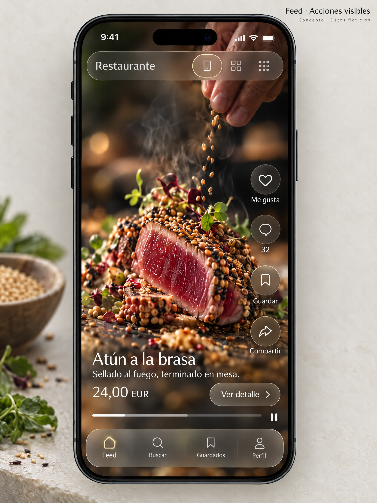
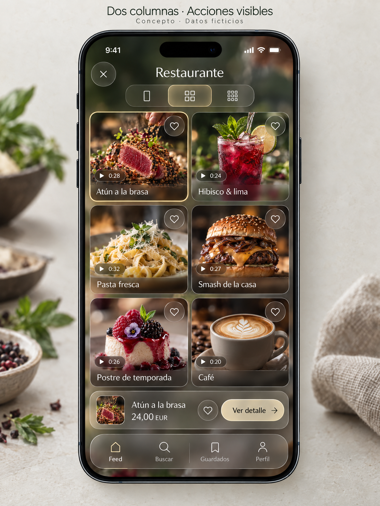
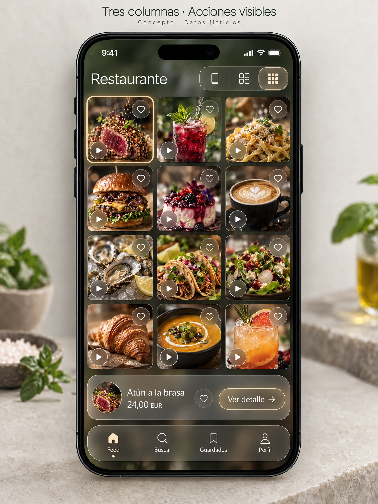
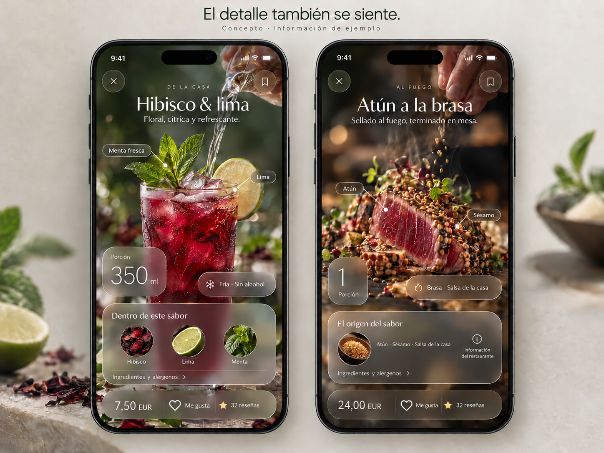

# Sistema de diseño gastronómico · v1.0

**Base visual aprobada · Especificación para implementación · 28 de octubre de 2026**  
**Autor: Manus AI**

Este sistema convierte las pantallas aprobadas en una base compartida para PWA en React, app en React Native y dashboard de gestión. La experiencia pública es un feed de video gastronómico con exploración por retículas y detalle editorial; no una carta tradicional con fotografías ni una tienda con carrito asumido.

La entrega incluye referencias, fundamentos, tokens generables, adaptadores de estilo, iconos y contratos de componentes. Es una **especificación v1**, no una biblioteca de componentes terminada ni una app de producción. La aprobación visual de cuatro pantallas no equivale a validar accesibilidad, rendimiento o todos los flujos del negocio.

## 1. La referencia vigente y lo que no se debe reinterpretar

La versión canónica es la aprobada después de incorporar corazones y botones explícitos de detalle. No se usan como referencia de implementación las primeras propuestas negro/lima, las versiones con serif y marcos dorados pesados ni la reconstrucción realizada para el video de transición.

La identidad aprobada combina fotografía cálida, cristal perla y ahumado, bordes finos marfil/champán, módulos orgánicos y tipografía sans limpia. El producto permanece visible entre las capas. El oro es un acento preciso; el neón, una señal localizada opcional, no un borde permanente alrededor de toda la aplicación.

La imagen inicial del dashboard se conserva solo como referencia de composición. Su rediseño final y sus pantallas internas todavía necesitan validación visual.

## 2. Qué necesitamos para tener un sistema real

Necesitamos mantener sincronizados cinco elementos: una biblioteca de diseño editable, una fuente de tokens, componentes por plataforma, patrones completos y un proceso de validación. Si falta esa conexión, tendremos imágenes bonitas y estilos sueltos, no un sistema que reduzca inconsistencias.

Este paquete cubre la especificación y parte de los activos técnicos. El siguiente trabajo de producción consiste en trasladar las referencias a Figma, construir los componentes web y nativos y probar el recorrido completo con contenido real. Esas actividades no se presentan como ya realizadas.

Antes de implementar el núcleo solo hay que aclarar lo que realmente cambia su arquitectura: quién publica cada menú y quién lo administra, si el descubrimiento será global o principalmente dentro de un restaurante y cuál es el primer mercado. El modelo de pagos se puede resolver después del núcleo visual, pero no se implementa un flujo financiero sin definir quién paga y quién recibe.

## 3. Principios de producto y marca

**Contenido primero.** El video es el escenario. La interfaz organiza la atención sin ocultar el plato. Un nombre y una descripción deben permitir comprenderlo incluso si el video falla o no puede reproducirse.

**Calidad sin barreras artificiales.** Una taquería, una cafetería y un restaurante de autor reciben el mismo cuidado. No se exige una producción cinematográfica para publicar ni se inventan distintivos de exclusividad. La aspiración debe surgir de la experiencia, no de aparentar certificaciones o popularidad.

**Acciones comprensibles.** Corazón significa Me gusta; marcador significa Guardar. Ver detalle es una acción visible, no una zona invisible que el usuario tenga que descubrir. Compartir y reseñar no se mezclan con esas acciones.

**Continuidad.** Cambiar de densidad o abrir información no reinicia la exploración. Restaurante, filtros, producto y estado de reproducción se conservan donde corresponda.

**Precisión antes que decoración.** Sin datos, no hay una cifra inventada. Sin precio, no aparece “gratis”. Sin reseñas, no se dibuja una puntuación de cero. Sin una declaración alimentaria, no se infiere que un ingrediente o alérgeno esté ausente.

## 4. Arquitectura del contenido y los permisos

El modelo inicial es restaurante → sucursal cuando corresponda → menú → categoría → plato o bebida. Una receta puede reutilizarse, pero precio, horario y disponibilidad se resuelven para su contexto publicado. Un local de una ubicación no tiene que configurar una organización compleja.

Cada producto conserva un identificador estable, nombre, descripción, media y estado editorial. Precio y moneda, porción, variantes, ingredientes, alérgenos y preferencias dietéticas se publican cuando corresponden y existe información declarada. Las bebidas admiten volumen, temperatura y atributos propios; un campo vacío no se convierte en “sin alcohol” o “sin cafeína”.

La autoría del contenido y la responsabilidad del restaurante se diferencian si existen creadores externos. No se atribuye una reseña o un video al negocio sin un flujo de permiso. Las reacciones a un producto y a un video requieren entidades y métricas distintas si se habilitan ambas.

Roles iniciales propuestos: visitante, persona registrada, editor y propietario del espacio. Moderación, analíticas y finanzas pueden ser permisos adicionales. El servidor aplica los permisos; ocultar un botón no impide por sí mismo una operación no autorizada.

Los horarios del local y los del menú no equivalen a disponibilidad del plato. “Cerrado”, “agotado por ahora” y “disponible en otro horario” son estados distintos. La información actualizada manualmente no se presenta como inventario en tiempo real.

## 5. Navegación por superficie

### PWA de consulta

Un enlace de restaurante abre su propio menú, no una portada global que haga perder el contexto. Leer el menú y el detalle no requiere instalar la app ni crear una cuenta. Cuando una acción necesita identidad, se solicita acceso en contexto y se recupera la acción después.

La propuesta de navegación es Feed, Buscar, Guardados y Perfil. Feed puede ser el menú del restaurante actual. Si se confirma descubrimiento entre restaurantes, se incorpora sin desplazar el contexto de un enlace directo.

### App en React Native

Conserva las mismas entidades y acciones, adaptadas a navegación nativa, áreas seguras y retroceso del sistema. Un mismo enlace identifica el producto en app o web. No se fuerza el mismo árbol de componentes ni se copian valores CSS de blur y sombras a APIs nativas.

Las notificaciones, publicación móvil, cámara y seguimiento de creadores son capacidades que deben validarse; no aparecen como requisitos únicamente por parecerse a una red social.

### Dashboard

La propuesta es Resumen, Menús y productos, Biblioteca multimedia, Comunidad, Analíticas, Pagos y Configuración. La biblioteca puede integrarse inicialmente en el editor. El selector de restaurante o sucursal debe hacer inequívoco qué contenido se está modificando.

El dashboard adopta superficies claras, lectura estable y densidad útil. Comparte tipografía, geometría, iconos y acento con la experiencia pública, pero no convierte tablas o finanzas en paneles translúcidos sobre video.

## 6. Fundamentos visuales

### Color por función

Los colores se consumen por roles como superficie, texto, acción, borde, foco y estado, no mediante hexadecimales repetidos en cada pantalla. `tokens/tokens.json` es la fuente de valores y `tokens/build_tokens.py` genera los adaptadores. Si se cambia una decisión, se regenera; no se corrige el CSS sin actualizar el origen.

La base pública usa negro mineral y verde-grafito muy oscuro, texto marfil, secundario cálido y champán contenido. El dashboard usa fondo mineral claro, tarjeta cálida y tinta verde oscura. El cian suave queda como detalle de atención opcional, no como sustituto de foco accesible.

Éxito, advertencia, peligro e información son independientes del color de marca. Se acompañan de texto o iconos. Un separador ornamental tenue no sirve como borde funcional cuando el borde es necesario para identificar un control.

La paleta base no autoriza a poner texto claro sobre cualquier video. Los materiales requieren un fondo compuesto verificable. Se aumenta opacidad o se aplica el fallback sólido si no se mantiene la lectura.

### Tipografía

Se propone Inter como sans compartida, con fallback de sistema mientras no se incorporen y registren las fuentes. No se utiliza una serif para reconstruir el detalle aprobado. La instalación y la revisión de métricas son parte del trabajo de implementación.

Escala inicial tamaño/interlineado: display 36/42, título de pantalla 28/34, sección 22/28, tarjeta 18/24, cuerpo 16/24, etiqueta 14/20 y metadato 12/16. Los títulos editoriales pueden usar un peso ligero, pero las acciones y los textos secundarios no se vuelven tenues para parecer delicados.

La información esencial se mantiene habitualmente en 14 o más unidades lógicas; el cuerpo largo usa 16. Se respeta el escalado del sistema y la ampliación en web. Los precios y las métricas pueden usar números tabulares cuando la fuente los incluya. Moneda y unidad nunca dependen de una fotografía.

### Geometría, espacio y elevación

La escala base de espacio parte de 4 y llega hasta 64. Un margen móvil de referencia es 16; las retículas pueden reducir sus separaciones sin reducir las áreas de los controles. Los radios se organizan por función: campos, tarjetas, módulos de media, paneles y cápsulas. No todo necesita ser una cápsula.

Los objetivos táctiles del producto serán de 48 unidades lógicas. Un trazo fino puede tener un área táctil amplia. Los iconos se dibujan sobre un viewBox 24 × 24 con trazo coherente; no se agrandan solo algunos hasta cambiar su peso visual.

La elevación tiene pocos niveles: contenido, controles superpuestos y superficies de lectura o diálogo. No se apilan sombras y resplandores para intentar crear profundidad. Las áreas seguras se calculan por plataforma, no mediante un padding fijo que suponga un modelo de teléfono.

## 7. Materiales de cristal y transparencia

**Cristal editorial perla.** Módulos informativos sobre imagen, con tinte cálido, borde fino y suficiente fondo para leer. Conserva el aspecto aprobado de porción, preparación y composición.

**Cristal ahumado funcional.** Navegación, selector, controles y barras de acción. Debe distinguirse del video sin formar una caja negra pesada.

**Superficie sólida de lectura.** Ingredientes extensos, reseñas largas, formularios, errores importantes y operaciones administrativas. La lectura es prioritaria frente al efecto.

El cristal editorial de las referencias es un lenguaje visual propio. No equivale automáticamente al material nativo Liquid Glass de Apple. Apple separa los materiales de contenido de la capa funcional de Liquid Glass y recomienda moderación en controles personalizados. Esta distinción evita aplicar el mismo efecto a toda la pantalla. [2]

En web puede emplearse desenfoque de fondo con alternativa sólida; en nativo se elige una implementación compatible y se prueba. Si hay transparencia reducida, soporte insuficiente o rendimiento degradado, se vuelve al material sólido sin perder acciones ni información.

No se valida accesibilidad midiendo únicamente el color de una capa semitransparente: hay que evaluar el resultado sobre fotogramas claros, oscuros y de mucho detalle. Los valores del kit son puntos de partida reproducibles, no un certificado sobre cualquier imagen.

## 8. Iconografía y acciones

El selector usa un rectángulo vertical para feed, cuatro celdas para dos columnas y nueve celdas para tres columnas. **No usa números visibles.** Cada opción conserva un nombre accesible y estado seleccionado. El icono representa la densidad, no una puntuación.

El corazón significa Me gusta y comunica su estado. Guardar utiliza marcador. El detalle conserva Guardar arriba y Me gusta en su barra inferior; así no hay dos marcadores que parezcan acciones distintas.

En el feed, Ver detalle aparece cerca del nombre y el precio. En las retículas, cada producto tiene corazón y la barra contextual muestra el producto seleccionado con Ver detalle. Se evita introducir seis botones largos en una celda diminuta de tres columnas.

El sprite `web/icons.svg` contiene la geometría canónica. La adaptación nativa conserva esas formas y pesos mediante el renderer SVG elegido. El área de 48 no está contenida en el dibujo de 24: la aporta el componente interactivo.

## 9. Feed y retículas como un mismo patrón

El feed ocupa el área útil de pantalla con un producto por escena. Un avance vertical cambia al siguiente. El carril social queda separado de la zona del gesto y el texto breve tiene un respaldo local que permita leerlo. Un fallo de video deja poster y acceso a información.

Solo un video reproduce a la vez. Se pausa al salir de pantalla, abandonar el feed o pasar a segundo plano. El autoplay inicial será silencioso si está permitido; si no, habrá un control de reproducción claro. Una imagen de fallback no simula una reproducción que no existe.

Cambiar a dos o tres columnas conserva el orden de lectura por filas, el identificador activo, filtros, contexto del restaurante y tiempo del producto cuando se vuelve a abrir. El activo permanece visible en su fila lógica; no se reordena para colocarlo primero.

Las retículas muestran posters y controles de video. Una previsualización, si se incorpora, se limita a un elemento y requiere un comportamiento predecible. No se cargan ni reproducen todos los videos de la pantalla simultáneamente.

En dos columnas caben nombres y datos breves. En tres se prioriza la imagen, el corazón y el acceso contextual al detalle. La densidad visual no es permiso para convertir controles en objetivos diminutos o títulos en microtexto ilegible.

En escritorio se conservan estas reglas dentro de una composición adecuada a videos verticales. No se estira el video vertical a todo el ancho del monitor. Búsqueda, categorías o información complementaria pueden ocupar zonas laterales sin alterar el orden del feed.

## 10. Detalle editorial aprobado

El detalle no es una hoja opaca con pestañas genéricas. El producto sigue visible y se organiza con título limpio, notas breves, dos etiquetas editoriales, pequeños módulos asimétricos y una tarjeta de composición. La barra inferior conserva precio, corazón y reseñas.

Las etiquetas de ingredientes son contenido editorial configurado por el restaurante, no detección automática. Se anclan a un poster o fotograma aprobado de detalle. No se dejan apuntando a coordenadas fijas mientras el video cambia de encuadre. Al cerrar se recupera el tiempo previo del feed.

Los módulos visibles dependen de datos reales. Un dato ausente no deja una caja decorativa vacía. Porción y preparación tienen una idea principal cada una. La tarjeta de composición utiliza imágenes pertinentes, no paisajes u otros recursos que insinúen un origen no documentado.

Ingredientes y alérgenos abre una lectura completa de alto contraste. La información sensible no se comprime en una etiqueta sobre el plato. Una reseña larga tampoco se limita al pequeño módulo editorial.

Cerrar tiene un control explícito y respeta el retroceso del sistema. En web se gestiona el foco y se devuelve al control que abrió el detalle. El scroll de una lectura o panel no avanza accidentalmente el video de fondo.

## 11. Movimiento especificado, no nuevos videos

El kit documenta movimiento, pero no añade videos a esta entrega. Las duraciones parten de respuesta breve de 120 ms, transición habitual de 180–240 ms y entrada editorial de hasta 320 ms. Son valores para probar en producto, no una secuencia obligatoria lenta en cada acción.

La entrada del detalle prioriza título, etiquetas y módulos mediante una secuencia breve. El contenido no espera una animación decorativa para estar disponible. El cambio de retícula conserva un ancla y reorganiza elementos, evitando reiniciar la colección.

La luz acompaña un cambio de atención una sola vez; no recorre permanentemente el perímetro. Un like tiene respuesta breve, no confeti constante. El estado permanece reconocible cuando termina la animación.

Con reducción de movimiento se eliminan transformaciones decorativas y se usa cambio directo o fundido breve. Esa preferencia no reemplaza los controles para pausar contenido automático. El sonido nunca se activa de sorpresa al abrir un detalle o cambiar columnas.

## 12. Contenido gastronómico, reseñas y confianza

Cada declaración sensible conserva fuente y fecha. Contiene, puede contener y no informado no son equivalentes. Las etiquetas dietéticas proceden del restaurante; no se infieren de fotos, subtítulos o listas incompletas. La configuración de categorías alimentarias se adapta al mercado de lanzamiento.

No se agregan certificaciones, garantía de ausencia de contaminación cruzada ni valores nutricionales estimados para completar el diseño. Se ofrece contacto con la sucursal si ese canal existe. La plataforma comunica datos; no convierte un filtro dietético en asesoría o garantía de seguridad.

Las reseñas incluyen autor, fecha, contexto y posibilidad de reportar. La valoración de un plato y la del restaurante necesitan contexto separado si ambas existen. No se muestra experiencia verificada sin un mecanismo real que la sustente.

Reportar no equivale a demostrar una infracción. Moderar deja motivo, actor y fecha. El restaurante no retira una crítica únicamente porque sea negativa. Las políticas y los permisos se definen antes de automatizar acciones.

## 13. Dashboard y analíticas

El editor debe permitir crear, cargar media, completar atributos, previsualizar y guardar o publicar según permisos. Se distinguen carga del archivo y procesamiento del video. Un error no elimina lo escrito. El autoguardado informa cuándo terminó o falló.

El resumen operativo puede mostrar métricas de contenido y comunidad. Cada tarjeta identifica periodo y unidad. Una apertura, un like o una reproducción no se llama venta. No se muestran ingresos si no existe una fuente transaccional definida.

Eventos propuestos: vista de menú, impresión de producto, apertura de detalle, inicio y final de media, reacción añadida o retirada, guardado añadido o retirado y reseña enviada. Se define la entidad a la que corresponden y la política de deduplicación. Los nombres de evento no sustituyen una definición de negocio.

Una posible impresión de referencia exige al menos 50% de visibilidad durante un segundo continuo; es una propuesta que debe fijarse y probarse antes de comparar resultados. La duración de sesión y el tratamiento de bucles también se especifican. Las tasas combinan numeradores y denominadores compatibles.

Zona horaria, moneda y fecha de actualización son explícitas. Datos ausentes y cero se diferencian. Monedas distintas no se suman sin un criterio de conversión definido. Consentimiento, retención de datos y base de medición dependen del mercado y la política de privacidad.

**Pagos permanece como una decisión de negocio abierta.** La suscripción del restaurante, los cobros a comensales y las liquidaciones a creadores son flujos diferentes. Se puede especificar la apariencia de un estado financiero, pero no crear saldos, comisiones, devoluciones o checkout sin el modelo real.

## 14. Estados que también forman parte del diseño

El sistema cubre carga inicial, poster disponible, video no reproducible, error de red, modo sin conexión, contenido archivado, restricción, sin resultados, ausencia de reseñas y falta de permisos. No se utiliza el mismo mensaje para un vacío legítimo y un fallo técnico.

Corazón y guardar tienen reposo, seleccionado, enviando y error. Una actualización optimista revierte y explica si falla. Las acciones repetidas no crean duplicados. Una cola sin conexión no se presenta como envío completado.

El contenido editorial tiene borrador, guardando, guardado, procesando media, publicado y archivado. Programación o revisión se añaden si la operación las necesita. Una carta guardada localmente indica fecha y que precios o disponibilidad pueden cambiar.

Los mensajes deben indicar qué ocurrió y qué puede hacer la persona: “No pudimos cargar el video. Puedes ver los detalles o intentar de nuevo”. No muestran códigos internos como único mensaje ni culpan al usuario.

## 15. Accesibilidad y adaptación por plataforma

Objetivo web: WCAG 2.2 AA, sujeto a evaluación de pantallas y procesos implementados. La norma exige, bajo sus condiciones y excepciones, contraste de texto normal de 4.5:1 y de texto grande de 3:1. La información visual necesaria para identificar controles y estados requiere 3:1 frente a colores adyacentes. [1]

Se verifican teclado, foco visible y no oculto por controles flotantes, ampliación, reflujo, nombres accesibles y mensajes de estado. No se depende únicamente de color, hover o gestos. El área táctil de 48 es una regla del producto, no una afirmación de que WCAG establezca universalmente ese mínimo.

Video pregrabado con audio informativo requiere los subtítulos aplicables; los controles de pausa y sonido permanecen accesibles. La implementación debe revisar también alternativas para información visual esencial. Un video sin audio no exime de describir el producto en texto. [1]

En React Native se usan las propiedades de rol, etiqueta, estado y contexto modal apropiadas, y se prueba por separado en VoiceOver y TalkBack. React Native documenta diferencias entre plataformas: aprobar una pantalla web no valida automáticamente el comportamiento nativo. [3]

La matriz de prueba incluye fotogramas claros y oscuros, transparencia reducida, movimiento reducido, red lenta, offline, texto ampliado, teclado y errores. El kit no contiene una certificación de accesibilidad ni resultados de dispositivos que no se hayan probado.

## 16. Qué se entrega a diseño y desarrollo

Los tokens internos tienen fuente JSON y adaptadores generados. El formato DTCG ofrece un mecanismo de intercambio con tipos y referencias; este kit no afirma conformidad ni importación directa únicamente por utilizar JSON. La conversión a una herramienta concreta debe validarse. [4]

La biblioteca Figma propuesta tendrá fundamentos, variables, componentes, patrones y plantillas, con modos para consumo y operación. Debe vincularse al mismo vocabulario y registrar qué está aprobado, en revisión o deprecado. El archivo nativo de Figma no está creado en esta entrega.

En código se proponen paquetes de tokens, iconos, UI web y UI nativa. Se comparten entidades, estados y contratos; el renderer, la navegación y la accesibilidad son específicos por plataforma. Los archivos CSS y TypeScript del paquete son adaptadores de estilo, no componentes React o React Native terminados.

El catálogo detallado se encuentra en `documentacion/componentes-y-patrones.md` y su manifiesto JSON. La implementación y las decisiones abiertas se desarrollan en los otros dos documentos. La guía visual estática es una muestra de fundamentos y componentes; no sustituye las pantallas aprobadas ni constituye una nueva dirección creativa.

## 17. Orden pragmático de implementación

Primero se construye un recorrido vertical: feed → retícula → detalle → Me gusta/Guardar → volver, usando media de ejemplo y simulando un fallo real. Se compara visualmente con la referencia canónica antes de extender la biblioteca. Este paso detecta problemas de material, estado y continuidad que una lista de componentes no revela.

Después se añade edición y publicación de contenido, permisos y gestión básica de reseñas. Las analíticas se incorporan con eventos definidos y comprobables. Pagos se implementa solo tras fijar el modelo y sus estados reales. No hace falta bloquear los fundamentos esperando esa decisión, pero tampoco fingirla cerrada.

Cada componente se considera listo cuando tiene variantes y estados, accesibilidad, comparación visual, adaptación por plataforma, ejemplos y pruebas de sus contratos. El cambio de un token o una composición requiere revisar los consumidores afectados y mantener un registro de cambios.

Para avanzar necesitaremos nombre/logo si existen, un pequeño conjunto de platos y bebidas con media y declaraciones autorizadas, el mercado inicial, responsables de publicación/moderación y la definición del pago. Con eso se transforma esta especificación en una biblioteca y un producto comprobables, sin volver a rediseñar lo que ya se aprobó.

## References

[1]: https://www.w3.org/TR/WCAG22/ "W3C: Web Content Accessibility Guidelines 2.2"
[2]: https://developer.apple.com/design/human-interface-guidelines/materials "Apple Human Interface Guidelines: Materials"
[3]: https://reactnative.dev/docs/accessibility "React Native: Accessibility"
[4]: https://www.designtokens.org/TR/2025.10/format/ "Design Tokens Community Group: Format Module 2025.10"
